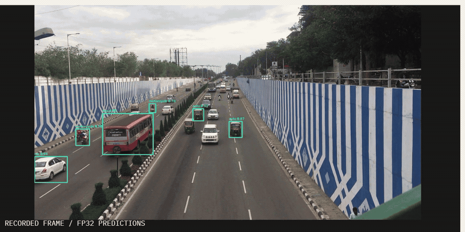
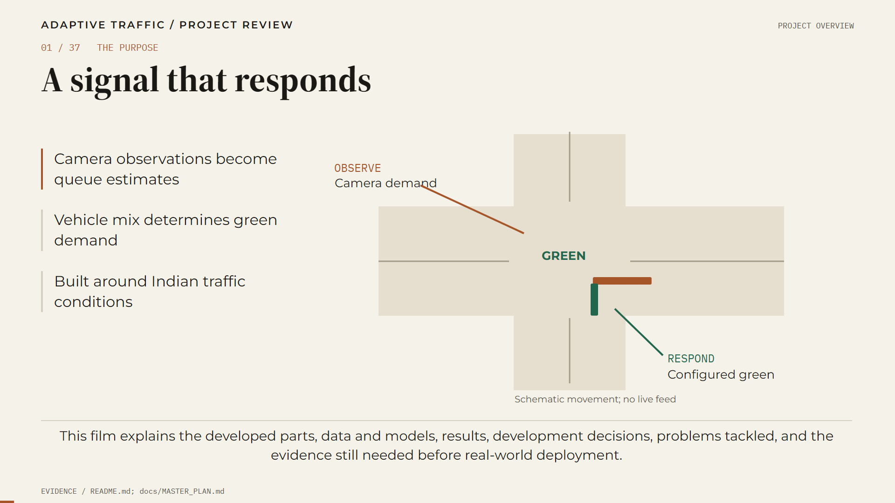
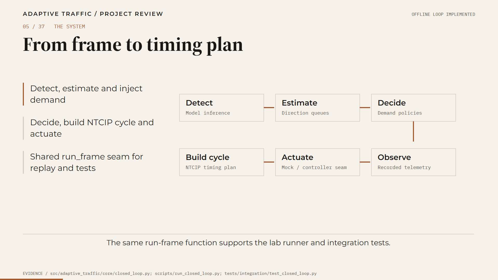
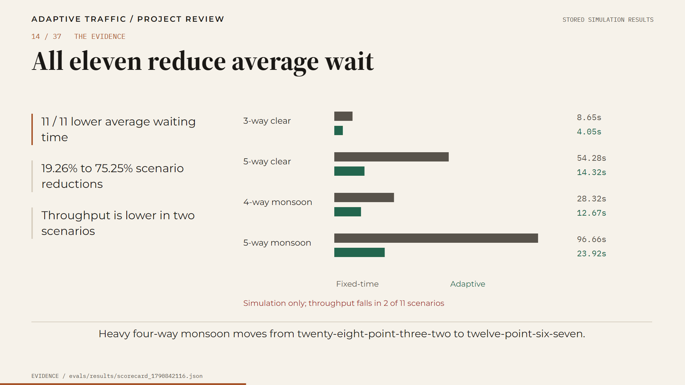

# The project film

[45-second trailer](https://github.com/Bobbymkr/SGP-IV/releases/tag/trailer-v1): a silent-tolerant
cut (music + kinetic type, no narration) that points here. Real held-out TrafficCAM frame, then
the evidence with MEASURED / SIMULATED tags — no claims the 15-minute film doesn't back.

A 15-minute, 37-chapter explanation of what this project built, what the measurements
actually say, what failed, and what is still missing before a field pilot.

**Runtime** 15:39.6 · **1920 × 1080, 24 fps** · H.264 / AAC · English narration · burned
captions (the alternate cut adds a selectable subtitle track) · 37 embedded chapters.

## Watch

| Cut | Style | Link |
|---|---|---|
| **Primary** | Warm-paper editorial, HyperFrames 0.8.156 refinement | [Watch / download (54 MB)](https://github.com/Bobbymkr/SGP-IV/releases/download/film-v1/Adaptive_Traffic_Signal_Timer_Hyperframes.mp4) |
| Alternate | Dark control-room cut, original render | [Watch / download (29 MB)](https://github.com/Bobbymkr/SGP-IV/releases/download/film-v1/Adaptive_Traffic_Signal_Timer_Project_Film.mp4) |

Both cuts carry the same narration, chapter structure and claims. The release page is
[`film-v1`](https://github.com/Bobbymkr/SGP-IV/releases/tag/film-v1).

| Poster | Pipeline | Evaluation |
|---|---|---|
|  |  |  |

## Chapter guide

The full timestamp list is in [`film/chapters.txt`](film/chapters.txt). Grouped by act:

| Act | Time | Chapters | What it establishes |
|---|---|---|---|
| Purpose and parts | 00:00–02:07 | 1–5 | The question, the implemented components, the architecture, the frame-to-green path |
| From frame to green | 02:07–04:55 | 6–12 | Detection on real CCTV, queue estimation, vehicle-mix greens, geometry, priority, city tuning, simulation |
| Simulation evidence | 04:55–06:11 | 13–15 | Adaptive vs fixed-time across eleven scenarios; why measurement came first |
| Data, training, model | 06:11–08:44 | 16–22 | BMD-45, the six-class contract, eight cumulative loops, the finale, per-class results, model history |
| Failures and fixes | 08:44–10:53 | 23–26 | The TrafficCAM domain gap, two INT8 failures, and the real-pixel bugs they exposed |
| Interfaces and readiness | 10:53–13:26 | 27–32 | Development loop, scheduler lessons, controller wire tests, monitoring and tiers, what is wired vs proven |
| Limits and path | 13:26–15:40 | 33–37 | Achievements, remaining field work, industry relevance, and the disciplined route to the road |

## What the film claims — and does not

The film is a project explanation, not a production certification. The claim-by-claim
table is in [`film/EVIDENCE.md`](film/EVIDENCE.md). The short version:

- **0.8477 mAP50** is detector mAP50 on the BMD-45 validation pool, not "accuracy", and
  not a field detection rate.
- **11/11 adaptive wins** and **19.26–75.25% lower average wait** are simulation results.
  They are not measured at a live junction. Adaptive throughput is lower in two scenarios;
  the film does not claim universal throughput gains.
- **1.83 ms p95 decide** at 300 detections and **5.1–8.2 fps CPU fp32** are lab and
  workstation measurements, not a field SLA.
- **INT8 is not promoted.** The original export was degenerate; the repaired v6b artifact
  is alive but misses the −0.02 mAP50 gate. Low tier runs fp32.
- The **TrafficCAM fine-tune** is a local-only candidate, not the canonical model.
- **No field deployment, no measured ROI, no completed controller or V2X interoperability.**
  Interfaces exist; hardware and site validation do not.

Evidence review: **14 October 2026**, against the working tree at that date.

## Evidence bundle

| File | Contents |
|---|---|
| [`film/EVIDENCE.md`](film/EVIDENCE.md) | Every claim mapped to source, config, metric or recorded artifact, with its limits |
| [`film/TRANSCRIPT.md`](film/TRANSCRIPT.md) | Full narration, chapter by chapter |
| [`film/chapters.txt`](film/chapters.txt) | 37 chapter timestamps |
| [`film/qa/pytest.txt`](film/qa/pytest.txt) | Test log at review time (109 passed, 1 skipped) |
| [`film/qa/flake8.txt`](film/qa/flake8.txt) | Lint log at review time (494 formatting findings; not a green gate) |
| [`film/assets/detections.json`](film/assets/detections.json) | Real held-out frame and the six FP32 predictions drawn in the film |

The QA logs are a **snapshot from 14 October 2026**, kept so the film can be audited
against the tree it describes. For the current gate, run `make verify` (or the Windows
commands in `AGENTS.md`).

## How it was made

The narration is synthetic (Microsoft Zira Desktop, rate 2). The 37 scenes were authored as
deterministic HTML/GSAP compositions and rendered locally at 1920 × 1080 / 24 fps, then
verified for full decode, audio, chapters and rendered motion. The editable HyperFrames
project and the generator for the dark cut live in the local `artifacts/` tree, which is
deliberately gitignored; the release assets, stills, transcript and evidence are the durable
public record.

No stock footage, invented testimonials, city deployment claims, measured ROI or external
industry endorsements are used. Traffic motion, graph layout, buffer flow and pipeline
diagrams are authored schematics. The held-out frame and its boxes are real model output.
